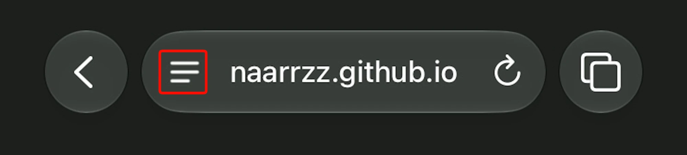
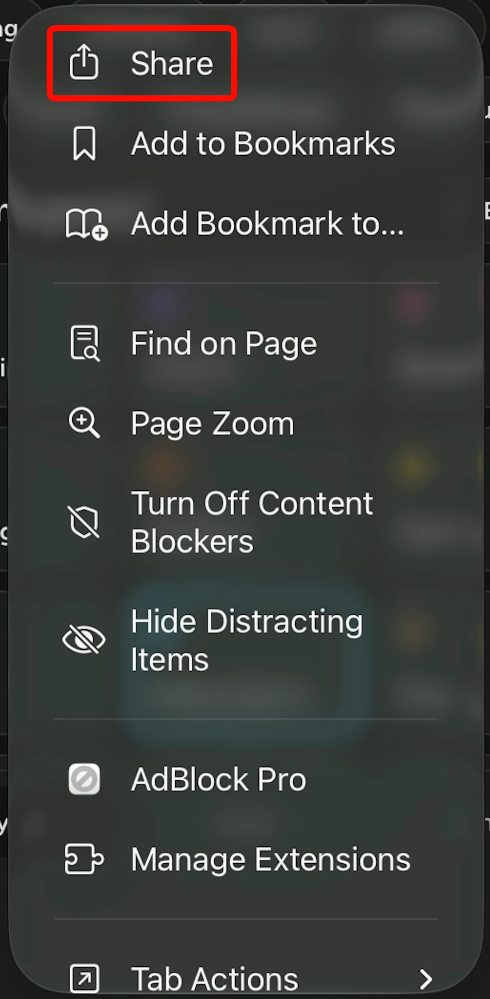
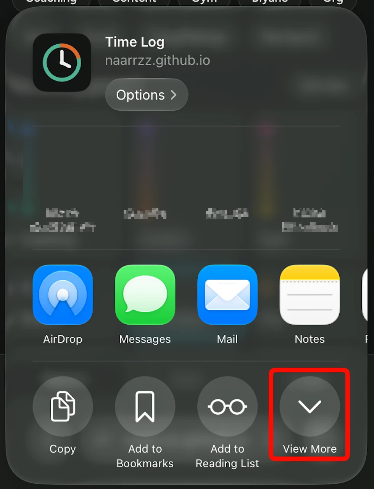
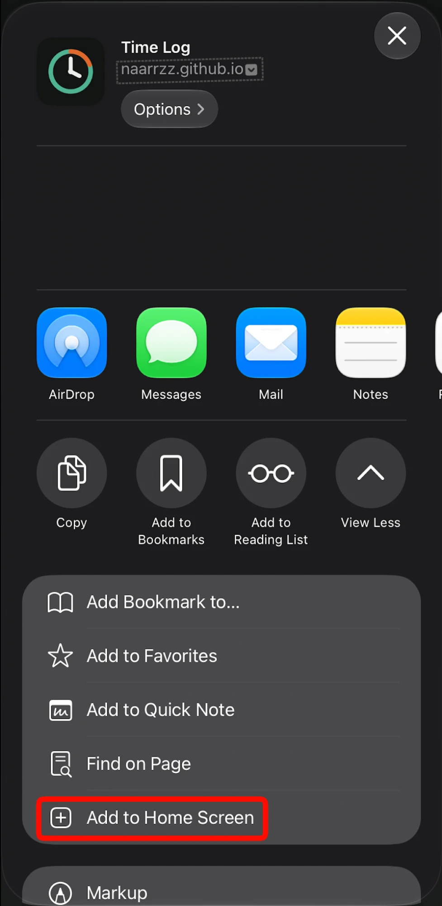

# Time Log

**Live demo:** https://naarrzz.github.io/time-log/

- **No account:** your logs are saved only in that browser on that device. They stay when you refresh or close the browser, but you can lose them if you clear your browsing data, use a private tab, remove the browser or home screen app, or don't open the app for a while in Safari.
- **With an account:** your logs are saved to your account, so they sync across your devices and stay even if you lose the browser.

A one-tap personal time audit app, built to see where my hours actually go between work, school, coaching, content and training.

- **Ngayon**: tap what you're doing; the timer runs until you tap something else. Forgot to switch? Backdate with 15 / 30 / 60 min chips.
- **Gaps**: walks you through unlogged stretches (15+ minutes) one at a time, on any day.
- **Week**: one plain insight, weekly goals, the last 7 days, totals per category, and a Kasabay summary. Tap a day to open it.
- **Kasabay**: anything running alongside the main activity, with its own start and end. It never adds time, so daily totals stay honest, and Week shows how much of your time was divided and which pairs happen most.

- **Sync and offline**: signed-in logs sync through Cloud Firestore in real time and keep working with no internet.
- **Sub-labels**: say what exactly you did in a tile, like Jeep under Biyahe. Optional, and Week shows the breakdown.
- **Backup and restore**: download every log as a JSON file, and add it back any time.
- **Themes**: Auto, Light, Dim and Dark, saved per device.

Single-file HTML/CSS/JS with no build step, plus a small service worker so the home screen app opens offline. `firestore.rules` limits each account to its own logs, which is why the Firebase web config can sit in public code.

## Add it to your iPhone home screen

It opens fullscreen like a normal app, and works offline after the first load. In Safari, open https://naarrzz.github.io/time-log/, then:

**1. Tap the menu button in the address bar.**

**2. Tap Share.**

**3. Tap View More.**

**4. Tap Add to Home Screen, then tap Add.**

Time Log now sits on your home screen. Open it from there from now on.

## Older versions

Updates reach the main link automatically, including on your home screen. To stay on an older version, open its link and add that to your home screen. It uses the same account and logs.

- [v0.4.0](https://naarrzz.github.io/time-log/versions/v0.4/)
- [v0.3.0](https://naarrzz.github.io/time-log/versions/v0.3/)
- [v0.2.2](https://naarrzz.github.io/time-log/versions/v0.2/)
- [v0.1.0](https://naarrzz.github.io/time-log/versions/v0.1/)
